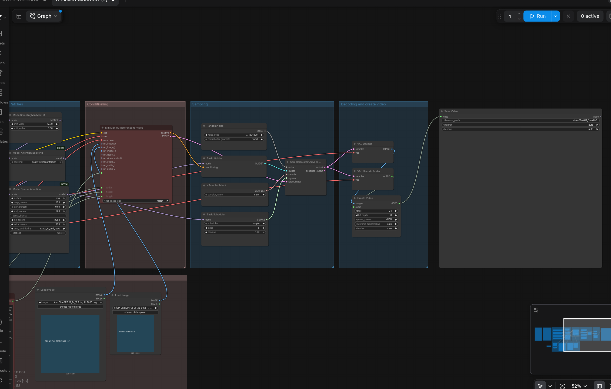
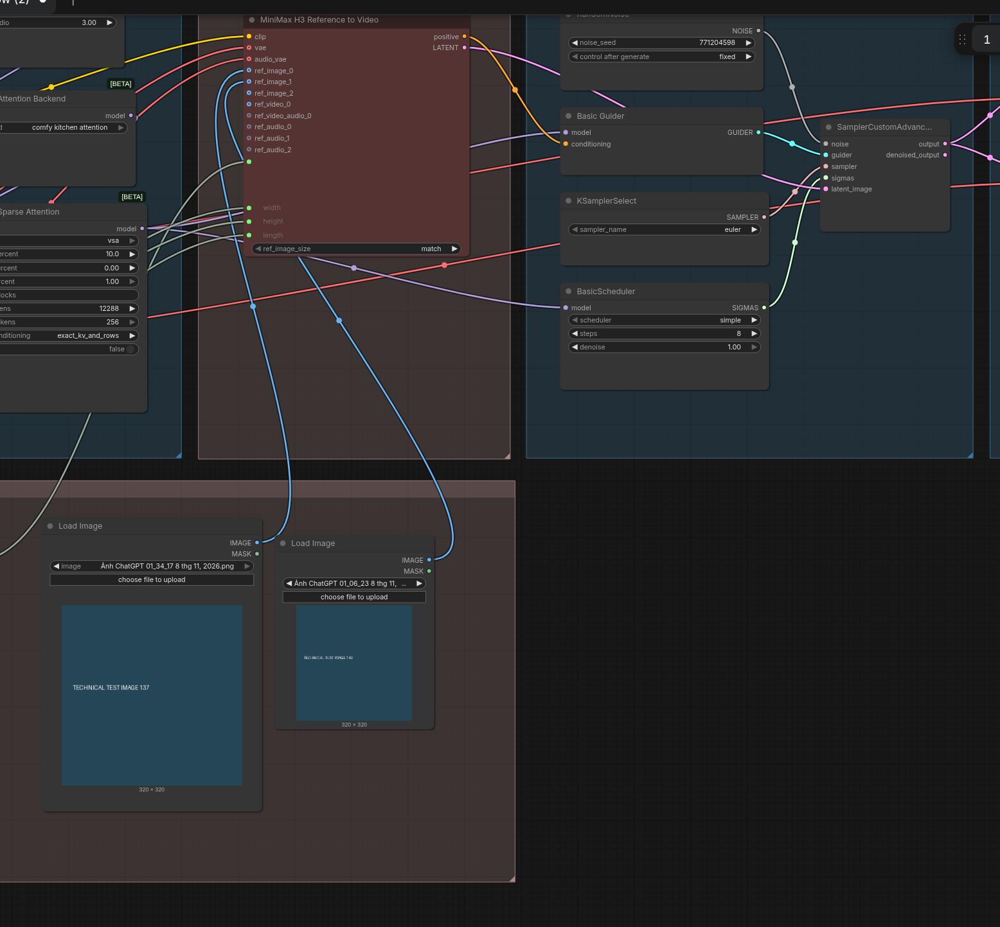
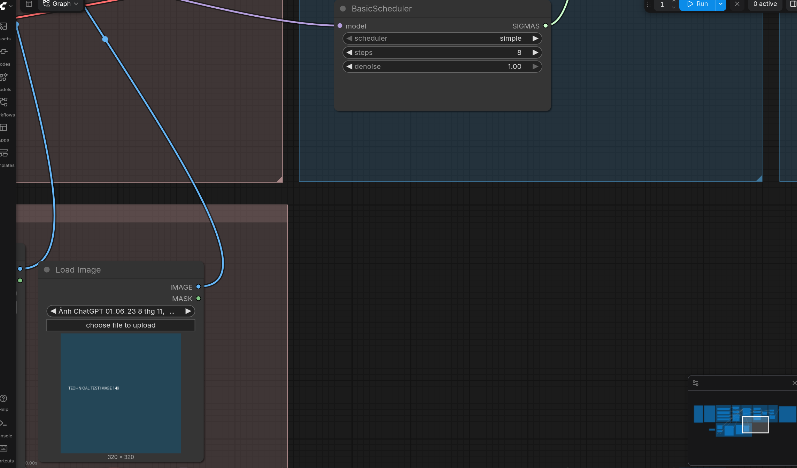
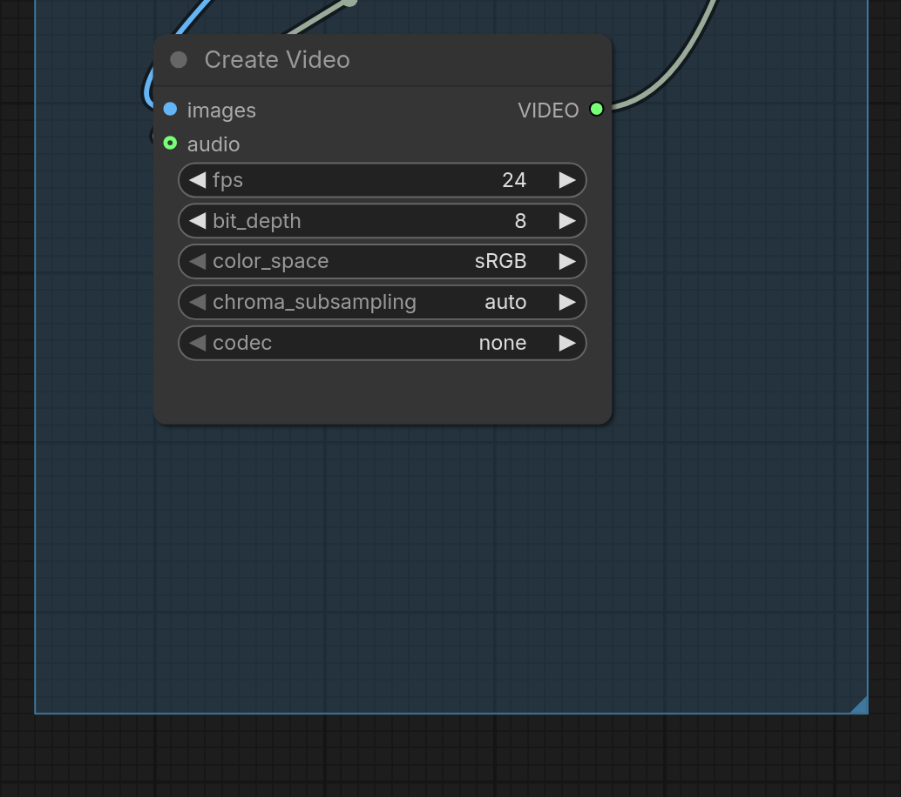

# FastH3 OmniRef · Workflow gốc

Bộ cài và hướng dẫn tiếng Việt · v1.0.0 · 10/11/2026. Đây là workflow TẠO video từ ảnh tham chiếu và prompt; chưa có bước upscale trong graph này.

Gói giữ nguyên video_fasth3_ominiref_r2v.json: 41.549 byte, 26 node và 28 dây nối. Không đổi prompt, model, seed, bố cục hoặc thông số. Không thêm LoRA, không chỉnh skill. Ảnh riêng của bạn không được đóng gói.

Dùng trong quy trình của bạn: tạo storyboard → bạn duyệt → tạo prompt dựa trên đúng storyboard → chọn storyboard và character sheet tại hai node ảnh → render video. Clip đã duyệt có thể chuyển sang RelayVSR để hậu kỳ.

Tệp gốc có một điểm khác schema ở ComfyUI mới: Create Video #130 lưu chroma_subsampling=none. Nếu giao diện có mục này, bạn chọn auto trước khi chạy. Bộ cài chỉ cảnh báo và vẫn giữ JSON nguồn nguyên byte.

# 1 · Cài và mở workflow

Đóng ComfyUI/backend, giải nén ZIP vào một thư mục bình thường rồi nhấp đúp CAI_DAT.bat. Không cần cài Git. Script dùng Python nhúng của ComfyUI Portable.

Đường dẫn mặc định: C:\Ai\ComfyUI_windows_portable_nvidia\ComfyUI_windows_portable. Thư mục đúng chứa cả ComfyUI và python_embeded. Nếu không tìm thấy, hộp chọn THƯ MỤC sẽ mở; chọn thư mục này, không chọn JSON.

Bộ cài không thay driver, Torch hoặc core. Nếu thiếu native node, cập nhật ComfyUI bằng updater chính thức của Portable rồi thử lại. Model cùng tên nhưng sai dung lượng/SHA256 được giữ nguyên và báo lỗi; bộ cài không ghi đè model đó.

File tải dang dở có đuôi .part và được tiếp tục khi máy chủ hỗ trợ Range. Model đã có được kiểm tra SHA256 trước khi dùng lại. Có hỗ trợ extra_model_paths.yaml; model đúng nằm trong thư mục con có thể được tạo hardlink đúng tên mà JSON gốc đang gọi.

Mở lại ComfyUI sau khi cài, đợi node nạp xong rồi chạy KIEM_TRA.bat. Kết quả kiểm tra dependency không phải bằng chứng render GPU thành công. Log nằm trong logs của bộ cài.

Sau khi cài, mở Workflow Browser → FastH3_OmniRef_Original → video_fasth3_ominiref_r2v. Hoặc kéo JSON trong workflows của gói lên canvas. Chỉ có một workflow gốc trong gói này.

| File | Công dụng |
| --- | --- |
| CAI_DAT.bat | Kiểm tra core, tải/dùng lại bốn model và chép JSON gốc |
| KIEM_TRA.bat | Kiểm tra file, node và danh sách model qua ComfyUI cổng 8188 |
| scripts/install.py check --port 8189 | CLI khi backend chạy ở cổng khác; dùng Python nhúng và thêm --portable đường_dẫn |

# 2 · Những gì được tải

Tổng bốn model khoảng 41,32 GB theo hệ thập phân. Nếu đã có ba model dùng chung của H3 đúng hash, phần tải mới thường chỉ còn checkpoint OmniRef khoảng 22,21 GB. Bộ cài in dung lượng còn cần trước khi tải.

Không có custom node hay LoRA trong file này: 21 loại node đều thuộc core ComfyUI. Không cài thêm pack H3 Studio cũ, GGUF loader hoặc bộ upscale không được workflow gọi.

RTX 4060 Ti không có tăng tốc FP4 phần cứng như Blackwell. Workflow gốc chọn encoder NVFP4 AWQ; khả năng nạp, mức offload và tốc độ phụ thuộc ComfyUI/Torch hiện có. Bộ cài không tự đổi encoder sang phiên bản khác. Chưa có benchmark hoặc bảo đảm vừa VRAM cho cấu hình gốc 1 MP/15 giây.

| Model / vị trí trong ComfyUI/models | Dung lượng GB |
| --- | --- |
| diffusion_models/fasth3_omniref_8step_pruned_int8_convrot.safetensors | 22.21 |
| text_encoders/qwen3vl_32b_minimax_h3_nvfp4_awq.safetensors | 15.69 |
| vae/minimax_h3_video_vae_int8_convrot.safetensors | 2.81 |
| vae/minimax_h3_audio_vae_fp32.safetensors | 0.61 |

# 3 · Storyboard và character sheet

Load Image #137 → ref_image_0 của MiniMaxH3ReferenceToVideo #136: Picture 1 là storyboard. Load Image #149 → ref_image_1: Picture 2 là character sheet. Chỉ số socket bắt đầu từ 0, nhưng tên Picture trong prompt bắt đầu từ 1.

Chọn ảnh thật bằng choose file to upload ở từng node. Tên ảnh tiếng Việt đã lưu trong JSON chỉ là tên file từ máy cũ, không có nghĩa bộ cài đã mang theo ảnh đó. Prompt được nhập ở node #138 và nối vào #136.

Prompt phải mô tả đúng thứ tự ô, nhân vật và thời gian trong storyboard đã duyệt. Không dùng Picture 3 khi chỉ nối hai ảnh. Một character sheet nhiều góc của Lan vẫn là một Picture 2; số góc trên sheet không tạo thêm ảnh tham chiếu độc lập.

Lưới 2×2, 2×3 hoặc 3×3 đều là một ảnh ở Picture 1. Node không tự cắt ô hay biến từng ô thành một shot chính xác. Prompt cần ghi đọc từ trái qua phải, từ trên xuống dưới, liệt kê Shot 1…n và yêu cầu không hiện lưới/nhãn shot trong video. Việc bám storyboard vẫn phụ thuộc model, không có cơ chế khóa tuyệt đối.

Workflow gốc đang nối hai ảnh. Nếu bạn đổi số ảnh hoặc bỏ character sheet, phải tự đồng bộ lại prompt và dây trong một bản làm việc riêng. Bộ cài không bypass ảnh và không tự viết lại prompt nguồn.

# 4 · Thời lượng, kích thước, tốc độ

PrimitiveFloat #132 là nơi chỉnh thời lượng bằng giây; giá trị gốc là 15. Math #131 chuyển thành số frame dạng 17n+5 ở 24 FPS: trường hợp gốc ra 362 frame, xấp xỉ 15,08 giây. Chú thích cũ nói 5 giây không phải giá trị đang nối thực tế.

ResolutionSelector #115 đang chọn 16:9, 1 megapixel và bội số 32, tạo 1376×768 trên core đã kiểm tra. Các ô width/height cũ bên trong #136 không quyết định kích thước khi đã có dây từ selector. Muốn phim dọc, chỉnh selector trong bản làm việc; gói nguồn vẫn là 16:9.

KSamplerSelect=euler; BasicScheduler=simple, steps=8, denoise=1. SigmaShift video=12, audio=3. Checkpoint đã chưng cất 8 bước nên giảm bước tùy tiện không bảo đảm giữ chất lượng hay lời nói.

BlockSparseAttention chọn vsa, keep_percent=10, start=0, end=1, min_tokens=12288. ModelAttentionBackend chọn comfy kitchen attention. Đây là thiết lập đã có sẵn; chưa đo phần nào tăng tốc thực tế trên RTX 4060 Ti.

Seed gốc là 771204598 và fixed. Giữ seed khi so sánh một thay đổi trong UI. Chạy lại với cùng seed không bảo đảm giống tuyệt đối giữa phiên bản/runtime khác nhau.

# 5 · Âm thanh và xuất video

H3 audio VAE decode âm thanh được model sinh, video VAE decode hình; cả hai đi vào Create Video #130. Workflow không có engine TTS tiếng Việt riêng nên không bảo đảm phát âm đúng chỉ bằng cách dùng bộ cài này.

Ở core có chroma_subsampling, chọn auto tại Create Video #130. Lỗi none không nằm trong danh sách là lỗi schema, không phải lỗi ảnh hay LoRA. Kiểm tra đã xác nhận: JSON gốc hợp schema core 0.43.1; core 0.44.0 báo lỗi mục này; chọn auto trong bộ nhớ giao diện thì hợp schema.

Create Video #130 giữ FPS 24, bit_depth=8, color_space=sRGB, codec=none theo gốc. SaveVideo #92 lưu dưới ComfyUI/output/video/ với tiền tố FastH3_OmniRef. Mục codec trong Create Video có ý nghĩa khác lựa chọn codec ở node lưu; không cần tự điền H.264 vào mọi ô.

Chưa có upscale hoặc phục hồi mặt cuối trong graph. Khi clip đã đúng diễn xuất, nhân vật và lời thoại, có thể dùng MP4 này làm đầu vào bộ RelayVSR riêng. Upscale không sửa chắc chắn một mặt/động tác đã sai từ video nguồn.

# 6 · Lỗi thường gặp và giới hạn kiểm tra

Image not loaded: chọn lại ảnh thật #137 và #149. Prompt nhắc Picture 2 nhưng không có ảnh: kiểm tra dây #149→ref_image_1 và ảnh có nạp thành công; đừng sửa số Picture tùy tiện chỉ để hết thông báo.

Thiếu native node hoặc Unknown model architecture: cần core hỗ trợ FastH3 OmniRef/H3; cập nhật chính thức rồi kiểm tra. Model đúng tên sai hash: giữ file, chuyển/đổi tên thủ công trước khi tải lại; không dùng model khác kiến trúc để lấp tên.

Out of memory: thiết lập gốc khá nặng. Dừng queue, giải phóng ứng dụng dùng GPU/RAM; nếu cần giảm kích thước/thời lượng thì lưu bản làm việc riêng. Bộ cài không hứa 15 giây 1 MP sẽ chạy vừa 16 GB VRAM/32 GB RAM.

Đã kiểm tra 11 ca installer, chạy install hai lần bằng Python -I trên Portable giả lập với model rất nhỏ, mở UI hai core, export API và validate_prompt. File model thật chỉ kiểm tra metadata/URL và 16 byte đầu, không tải 41 GB để suy luận.

Chưa chạy launcher Windows, chưa render GPU, chưa so sánh tiếng Việt, tốc độ hoặc chất lượng phim trên RTX 4060 Ti. Xem reports và VALIDATION.md để biết ranh giới kiểm tra.

SHA256 bản gốc: eb2d92ae93e151d4d86dc697c845e428e2b33ce4e845d1859f28654f4f64d0c7
