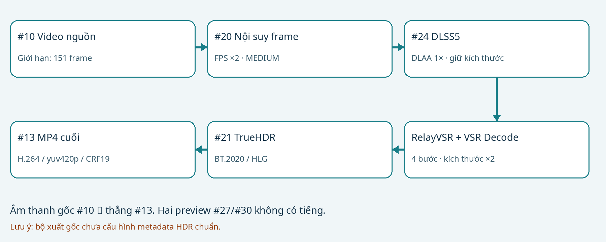
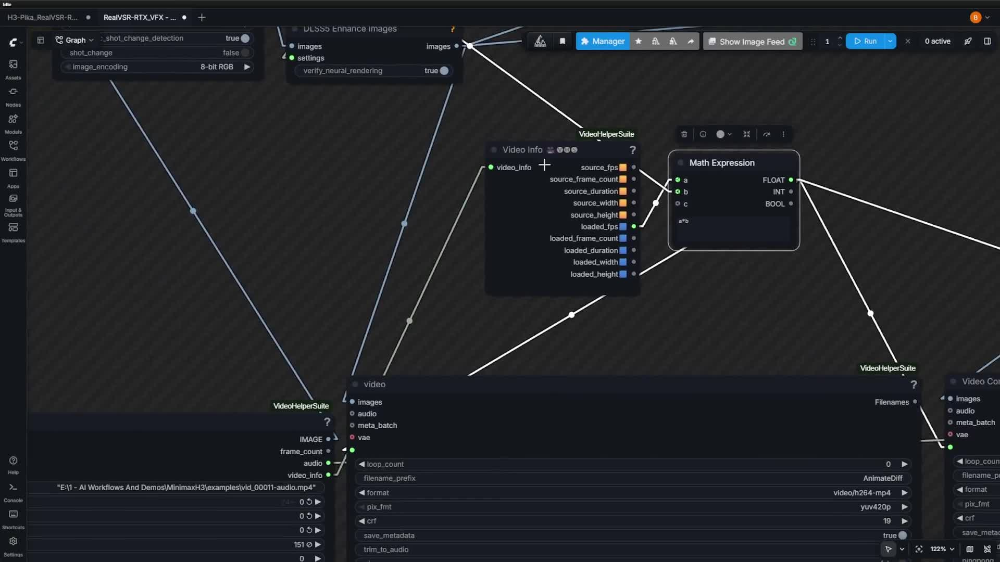
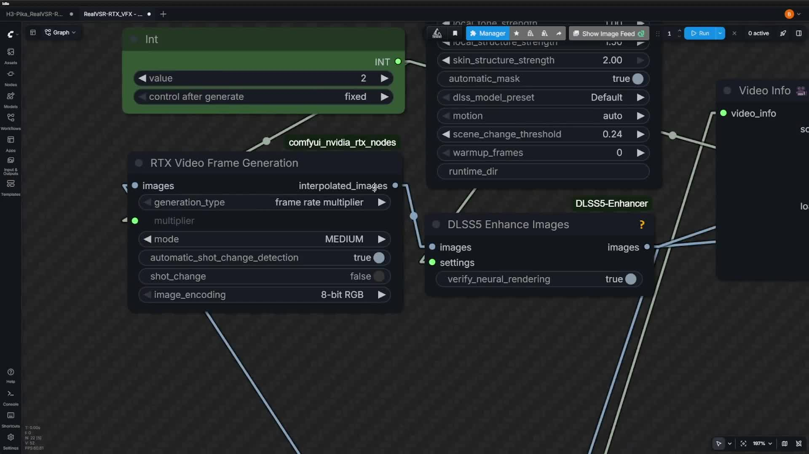
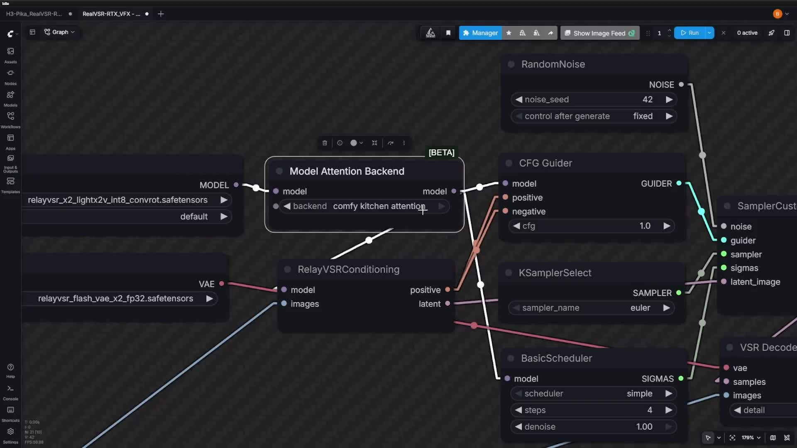

# RelayVSR + RTX VFX · Upscale bản gốc

Bộ cài và hướng dẫn tiếng Việt · v1.0.0 · 10/11/2026. Dành cho VIDEO ĐÃ CÓ. Tên tệp là RealVSR-RTX_VFX - upscale.json, nhưng model và node thực tế là RelayVSR. Không phải workflow tạo video từ storyboard.

Giữ nguyên file bạn gửi: 32.359 byte, 21 node và 30 dây nối. Không chỉnh setting, model, seed, dây, tên hoặc bố cục. Bộ cài chỉ cung cấp dependency, model và bản sao JSON đúng từng byte; skill không thay đổi.

Luồng thực tế: nạp video → nội suy frame ×2 → DLSS5 DLAA 1× → RelayVSR upscale kích thước ×2 → TrueHDR → MP4. Âm thanh nguồn nối thẳng sang node lưu cuối.

Đây là bộ riêng bên cạnh OmniRef. Dùng OmniRef để tạo clip từ storyboard trước; sau khi duyệt clip mới đưa MP4 vào RelayVSR. Không nạp storyboard vào ô video của bộ upscale.

# 1 · Chuẩn bị và cài đặt

Đóng ComfyUI/backend, giải nén ZIP vào một thư mục bình thường rồi nhấp đúp CAI_DAT.bat. Không cần cài Git. Script dùng Python nhúng của ComfyUI Portable.

Đường dẫn mặc định: C:\Ai\ComfyUI_windows_portable_nvidia\ComfyUI_windows_portable. Thư mục đúng chứa cả ComfyUI và python_embeded. Nếu không tìm thấy, hộp chọn THƯ MỤC sẽ mở; chọn thư mục này, không chọn JSON.

Bộ cài không thay driver, Torch hoặc core. Nếu thiếu native node, cập nhật ComfyUI bằng updater chính thức của Portable rồi thử lại. Model cùng tên nhưng sai dung lượng/SHA256 được giữ nguyên và báo lỗi; bộ cài không ghi đè model đó.

Phần NVIDIA VFX Nodes 0.2.1 yêu cầu PyTorch CUDA 13.0+ theo README upstream. Bộ cài kiểm tra CUDA hoạt động và từ chối trước khi tải model nếu môi trường không phù hợp. Nó không tự nâng Torch hoặc thay Portable của bạn.

RTX 4060 Ti thuộc dòng RTX 40, đáp ứng điều kiện dòng card của frame generation; điều đó không chứng minh toàn bộ pipeline vừa RAM/VRAM hoặc DLSS worker chạy được trên máy bạn. Cần driver NVIDIA tương thích bản CUDA/PyTorch đang dùng; thông số tối thiểu SDK riêng không thay thế điều kiện driver của CUDA.

Trình cài DLSS upstream hiện thông báo giấy phép và hỏi Continue? [y/N]. Đọc rồi nhập y nếu bạn đồng ý. Bộ cài không tự chấp nhận và không vô hiệu hóa phần mềm bảo vệ. Nếu từ chối, model/node đã cài vẫn còn; chạy CAI_RUNTIME_DLSS.bat khi muốn tiếp tục.

| File | Công dụng |
| --- | --- |
| CAI_DAT.bat | Kiểm tra môi trường, cài node/SDK, tải model, chép JSON gốc, chạy trình cài runtime DLSS |
| CAI_RUNTIME_DLSS.bat | Tiếp tục phần runtime nếu trước đó chưa cài; không tải lại model |
| KIEM_TRA.bat | Sau khi mở lại ComfyUI: kiểm tra SDK, binary DLSS, node, model và SHA của workflow |

# 2 · Model, node và runtime

Hai model Relay tổng khoảng 5,29 GB. Không cần checkpoint H3, Qwen encoder hay audio VAE H3 cho workflow này. Các file SDK/DLSS là runtime bổ sung, không phải model H3. Nên để dư nhiều GB cho giải nén, output và bộ nhớ ảo.

Model và source node được cố định revision/SHA256 trong manifest.json. Ba ZIP source nhỏ trong vendor đã kèm giấy phép upstream trong archive. Binary NVIDIA/DLSS không được đóng gói lại; tải từ nguồn chính thức/upstream khi bạn cài.

DLSS5 Enhancer là tích hợp cộng đồng Blueforcer, dùng worker Windows D3D12. Không coi nó là cam kết hỗ trợ chính thức DLSS5 cho mọi card RTX. Bộ cài giữ runtime/ffmpeg/config hiện có khi cập nhật source node và chuyển bản node cũ ra backup ngoài custom_nodes.

Không cần cài lại H3 Studio hoặc các node H3TakeLoad/H3TakeSave cho bộ này. RelayVSRConditioning và VSRDecode là node native mới; thiếu chúng thì cập nhật core ComfyUI.

| Thành phần | Mục đích / dung lượng |
| --- | --- |
| diffusion_models/relayvsr_x2_lightx2v_int8_convrot.safetensors | 5.16 GB |
| vae/relayvsr_flash_vae_x2_fp32.safetensors | 0.13 GB |
| NVIDIA VFX SDK 0.2.0.0 | Tải wheel Windows từ pypi.nvidia.com; khoảng 436 MB cho Python 3.12+ |
| DLSS5 runtime v3.0 | Tải bởi script upstream; khoảng 467 MB ZIP, giải nén lớn hơn |
| Ba pack custom node | DLSS5 Enhancer, NVIDIA VFX Nodes 0.2.1, VideoHelperSuite; source được kèm trong vendor |

# 3 · Chọn video và hiểu FPS

Mở Workflow Browser → RelayVSR_RTX_Original → RealVSR-RTX_VFX - upscale. Tại VHS_LoadVideoPath #10, nhập đường dẫn tuyệt đối tới MP4 thật, ví dụ C:/Ai/clips/Lan_15s.mp4. Ô này đang trống trong bản gốc; không phải hộp nhập prompt.

force_rate=0 giữ FPS nguồn; custom_width/custom_height=0 giữ kích thước nguồn. skip_first_frames=0, select_every_nth=1. format=AnimateDiff là định dạng loader VHS, không yêu cầu tải model AnimateDiff.

frame_load_cap=151 giới hạn 151 frame đầu được nạp. Với video 24 FPS chỉ tương đương khoảng 6,29 giây, không tự chạy hết clip 15 giây. Đây là setting gốc; nếu muốn thay giới hạn hãy lưu một bản làm việc và cân nhắc RAM.

VideoInfo #14 lấy loaded_fps. Math #22 tính a*b với b từ PrimitiveInt #23=2. Kết quả này đi vào frame_rate của cả ba node xuất. Giá trị 8 FPS cũ hiển thị/lưu trong widget không điều khiển khi đã nối dây.

RTXVideoFrameGeneration #20 dùng multiplier=2, MEDIUM, tự phát hiện chuyển shot=true, shot_change=false, 8-bit RGB. N frame tạo (N−1)×2+1 frame; 151 tạo 301. 24 FPS thành 48 FPS, không tạo thành video chậm gấp đôi; chênh thời lượng khoảng một nửa frame có thể xuất hiện ở điểm cuối.

# 4 · DLSS5 và phong cách nhân vật 3D

DLSS5Settings #25 → DLSS5EnhanceImages #24. upscaling_mode=1x (DLAA / native), nên bước này xử lý chất lượng ở kích thước nguồn; phần tăng kích thước 2× nằm ở RelayVSR phía sau.

nr_preset=Default; nr_style=Default; nr_intensity=1; local_tone_strength=1; local_structure_strength=1.5; skin_structure_strength=2; automatic_mask=true. motion=auto; scene_change_threshold=0.24; warmup_frames=0; runtime_dir để trống cho tự tìm.

local_structure tác động chi tiết bề mặt; skin_structure cùng mask tác động vùng da. Với style 3D bán hiện thực Á Đông pha búp bê, tăng cấu trúc da có thể làm da trông thật hơn hoặc lệch độ mịn bạn muốn. Nó không khóa danh tính, không thay character sheet và không bảo đảm giữ hình dáng mặt tuyệt đối.

verify_neural_rendering=true yêu cầu worker trả kết quả neural rendering hợp lệ thay vì coi xử lý không hoạt động là thành công. Thiếu runtime hoặc lỗi D3D12 phải xử lý ở môi trường, không phải thêm prompt vào workflow upscale.

Để đánh giá style, so frame gốc, preview #27 sau DLSS và preview #30 sau Relay tại cùng thời điểm: mắt, miệng, đường tóc, cổ áo, viền tay, da và chuyển động nhanh. Bản cài giữ nguyên các mức trên; mọi thử nghiệm setting là thao tác của bạn trên bản làm việc.

# 5 · RelayVSR và mức chi tiết

UNETLoader #2 nạp relayvsr_x2_lightx2v_int8_convrot.safetensors. ModelAttentionBackend #16 chọn comfy kitchen attention. RelayVSRConditioning #1 nhận model và ảnh sau DLSS, tạo conditioning cùng latent cho sampler.

Conditioning từ ảnh được nối vào cả positive và negative của CFGGuider #17, CFG=1. Đây là wiring gốc, không phải thiếu text prompt. Không có text encoder trong pipeline này.

RandomNoise #5 seed=42 và fixed; KSamplerSelect #8=euler; BasicScheduler #9=simple, steps=4, denoise=1. Dù mô tả model/video giới thiệu có nói chế độ ít bước/1 bước, file bạn gửi đang dùng 4 bước. Bộ cài không đổi xuống 1 bước.

VAELoader #12 nạp flash VAE x2 fp32; VSRDecode #19 dùng detail=1 và ảnh sau DLSS làm nguồn. Relay xử lý keyframe rồi decoder khôi phục các frame còn lại. Giảm detail trộn gần nguồn hơn, có thể giảm cảm giác gắt nét; thay đổi này chưa được áp dụng trong file gốc.

Đầu ra tăng mỗi chiều 2×: 1280×720 thành 2560×1440, tổng pixel tăng 4×. Không dùng nhầm checkpoint x4 với VAE x2 chỉ bằng đổi tên file. Upscale không thể khôi phục chắc chắn chữ, hình học hoặc danh tính đã sai từ đầu.

# 6 · File cuối, âm thanh và HDR

VHS_VideoCombine #13 là file cuối: images từ TrueHDR #21; audio từ video nguồn #10; FPS từ Math #22. filename_prefix=vsr_upscale/video; format=video/h264-mp4; pix_fmt=yuv420p; CRF=19; save_output=true; trim_to_audio=false.

File nằm trong ComfyUI/output/vsr_upscale/ và tên video có số đếm. Hai VideoCombine #27 và #30 chỉ preview tạm, save_output=false và không nối audio. Preview không có tiếng là đúng dây gốc, không có nghĩa file cuối mất tiếng.

Nếu video gốc không có track âm thanh, workflow không sinh thêm giọng nói. Nếu cap 151 cắt ngắn hình mà âm thanh nguồn dài hơn, kiểm tra duration hình/tiếng của file xuất; trim_to_audio=false không phải cơ chế đồng bộ lại nội dung. Không thêm TTS hoặc viết lại lời thoại trong bộ này.

TrueHDR #21 đang bật: contrast=100, saturation=100, middle_gray=50, luminance=650, debanding=true, output_colorspace=HDR, tức BT.2020/HLG theo node. Tuy nhiên node chỉ trả tensor IMAGE, không mang metadata màu sang VHS.

Bộ xuất gốc H.264/yuv420p là 8-bit và không cấu hình signaling HDR/HLG phù hợp. Vì vậy không gọi MP4 này là HDR chuẩn, màu có thể lệch/nhạt trên trình phát SDR. Muốn SDR trung tính hoặc xuất HDR đúng cần chủ động thay wiring/export trong một bản riêng; bộ cài hiện giữ nguyên nguồn theo yêu cầu.

# 7 · Bộ nhớ, lỗi và phạm vi kiểm tra

Không suy từ 5,29 GB model rằng toàn workflow nhẹ. Nội suy trước upscale tăng số frame; 301 frame ở 2560×1472 RGB float32 đã khoảng 13,6 GB cho một batch hình, chưa tính batch khác, model và buffer. RAM 32 GB có thể thiếu khi nhiều đầu ra giữ ảnh cùng lúc; chưa đo peak RAM/VRAM trên máy bạn.

Thiếu RelayVSRConditioning/VSRDecode: cập nhật core. Thiếu RTX node hoặc nvvfx import failed: xem log ComfyUI, kiểm tra SDK, driver và PyTorch CUDA theo yêu cầu upstream; không cài nhầm wheel Linux vào Windows.

DLSS runtime missing/worker protocol: chạy CAI_RUNTIME_DLSS.bat; cần runtime v3.0 / protocol 4. Nếu phần mềm bảo vệ cách ly binary, kiểm tra nguồn và lịch sử bảo vệ; bộ cài không tự tắt bảo vệ hoặc tạo ngoại lệ. Không dùng file DLL ngẫu nhiên để thay.

Đã chạy 18 ca kiểm tra installer và hai lượt install --files-only bằng Python -I trong môi trường Portable giả lập. Đã kiểm SHA/workflow/wiring, đăng ký được 17/19 loại node thật và schema DLSS/Relay/VHS; hai node NVIDIA được kiểm tra trường từ source.

SDK NVIDIA chính thức đã được thử import trên Linux CPU và bị chặn vì không có libcuda.so.1; Windows D3D12 worker không chạy được ở đây. Do đó chưa validate toàn prompt gốc, chưa test launcher Windows, chưa render GPU và chưa benchmark tốc độ/chất lượng trên RTX 4060 Ti. --files-only là chế độ kỹ thuật, không phải cài hoàn chỉnh.

SHA256 bản gốc: b7ab1d4a880bbec75c0b99957ee6db2b72636967cbc06ec58da2eef05366fa9e
